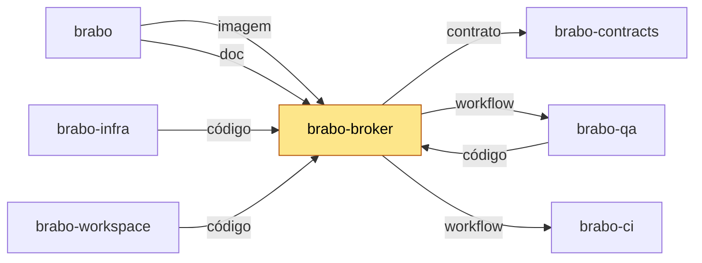

# brabo-broker

[](https://github.com/viralabs-dev/brabo-broker/actions/workflows/ci.yml?query=branch%3Adev) [](https://github.com/viralabs-dev/brabo-broker/actions/workflows/ci.yml?query=branch%3Amain) [](https://github.com/viralabs-dev/brabo-broker/tags) [](https://github.com/viralabs-dev/brabo-broker/releases/latest) [](LICENSE) [](https://viralabs-dev.github.io/brabo/prd/) [](https://ko-fi.com/daneiel)

O único processo do Brabo que fala com o daemon Docker do servidor.

## Para que existe

O broker não aceita especificação de container. Recebe um `projectId` e uma das seis operações
do `DockerPort` (`start`, `stop`, `remove`, `inspect`, `exec` e `app/restart`, RN-1025), lê a
decisão do Arquiteto na api e compõe a especificação ele mesmo. Não publica porta: só a api
chega nele. O socket do Docker dá controle do host, por isso fica num processo só (ADR 0130).

## Onde se encaixa

A api é a única que chama o broker, e o compose do `brabo-infra` o sobe com o socket montado.
A tabela e o diagrama abaixo são gerados do `repos.yml` do `brabo`, com este repo destacado.

<!-- mapa:inicio -->
<!-- Gerado do repos.yml do brabo por brabo-ci:scripts/ci/mapa-dos-repos.ts. Não edite à mão. -->

**brabo-broker** — Único processo com o socket do Docker do servidor. Imagem publicada por tag, usada pelo brabo e pelo brabo-infra.

| repo | propósito | como é usado | depende de | é usado por |
|---|---|---|---|---|
| [brabo](https://github.com/viralabs-dev/brabo) | Porta de entrada do produto — documentação agregada, site, instalador e release. | Quem instala usa o `install.sh` e as imagens e o binário das tags de `componentes.json`; o brabo-infra o clona nas aferições cruzadas. | brabo-api (imagem, doc), brabo-engine (imagem, doc), brabo-web (imagem, doc), brabo-broker (imagem, doc), brabo-runner (imagem, doc), brabo-infra (imagem, código, doc), brabo-contracts (contrato, doc), brabo-ci (doc, workflow), brabo-qa (doc) | brabo-ci (contrato), brabo-infra (código), brabo-workspace (código) |
| [brabo-api](https://github.com/viralabs-dev/brabo-api) | API do produto (NestJS, Drizzle, PostgreSQL/pgvector) — schema, RBAC, LLM, metering e gates. | Imagem publicada por tag e consumida pelo brabo e pelo brabo-infra; o brabo-web, o brabo-engine e o brabo-qa leem o código ou o `openapi.json` dele. | brabo-contracts (contrato), brabo-infra (código), brabo-qa (workflow), brabo-ci (workflow) | brabo (imagem, doc), brabo-engine (código), brabo-web (contrato), brabo-contracts (contrato), brabo-infra (código), brabo-qa (código), brabo-workspace (código) |
| [brabo-engine](https://github.com/viralabs-dev/brabo-engine) | Engine (Elixir/OTP, Phoenix, Oban) — agentes, sessões, gates e roteamento de runners. | Imagem publicada por tag, usada pelo brabo e pelo brabo-infra. | brabo-contracts (contrato), brabo-api (código), brabo-runner (código), brabo-qa (workflow), brabo-ci (workflow) | brabo (imagem, doc), brabo-infra (código), brabo-qa (código), brabo-workspace (código) |
| [brabo-web](https://github.com/viralabs-dev/brabo-web) | Interface web (React 19, Vite) — telas, i18n e design system. | Imagem publicada por tag, usada pelo brabo e pelo brabo-infra. | brabo-contracts (contrato), brabo-api (contrato), brabo-qa (workflow), brabo-ci (workflow) | brabo (imagem, doc), brabo-infra (código), brabo-qa (código), brabo-workspace (código) |
| [brabo-runner](https://github.com/viralabs-dev/brabo-runner) | CLI `brabo-runner` na máquina do usuário — PTY, container local e espelho. | Binário publicado por tag, instalado pelo brabo; o brabo-engine e o brabo-qa leem o código dele nos testes. | brabo-contracts (contrato), brabo-ci (workflow) | brabo (imagem, doc), brabo-engine (código), brabo-infra (código), brabo-qa (código), brabo-workspace (código) |
| **brabo-broker** | Único processo com o socket do Docker do servidor. | Imagem publicada por tag, usada pelo brabo e pelo brabo-infra. | brabo-contracts (contrato), brabo-qa (workflow), brabo-ci (workflow) | brabo (imagem, doc), brabo-infra (código), brabo-qa (código), brabo-workspace (código) |
| [brabo-contracts](https://github.com/viralabs-dev/brabo-contracts) | Contratos compartilhados — os pacotes `shared` e `docker-port`, `areas.json` e `fluxo.yml`. | Consumido por TAG (pacote no GitHub Packages ou arquivo baixado por raw na mesma tag); uma tag nova pede bump em api, web, runner, broker, engine, qa e infra. | brabo-api (contrato), brabo-ci (workflow) | brabo (contrato, doc), brabo-api (contrato), brabo-engine (contrato), brabo-web (contrato), brabo-runner (contrato), brabo-broker (contrato), brabo-infra (código), brabo-qa (contrato), brabo-workspace (código) |
| [brabo-ci](https://github.com/viralabs-dev/brabo-ci) | Workflows reutilizáveis e a política de PR, escada de aprovação, promoção, tag e Dependabot. | Cada repo chama `uses: viralabs-dev/brabo-ci/...@<sha>`, fixado por SHA. | brabo-qa (contrato, workflow), brabo (contrato) | brabo (doc, workflow), brabo-api (workflow), brabo-engine (workflow), brabo-web (workflow), brabo-runner (workflow), brabo-broker (workflow), brabo-contracts (workflow), brabo-infra (workflow), brabo-qa (workflow), brabo-workspace (código, workflow) |
| [brabo-infra](https://github.com/viralabs-dev/brabo-infra) | Composes, Dockerfiles de integração, `deploy/k8s`, scripts de dev, release e cadeia de suprimentos. | O brabo clona o brabo-infra no ref de `componentes.json` para subir a instalação; o brabo-api e o brabo-qa o clonam no CI. | brabo-api (código), brabo-engine (código), brabo-web (código), brabo-broker (código), brabo-runner (código), brabo-contracts (código), brabo (código), brabo-qa (workflow), brabo-ci (workflow) | brabo (imagem, código, doc), brabo-api (código), brabo-qa (código), brabo-workspace (código) |
| [brabo-qa](https://github.com/viralabs-dev/brabo-qa) | E2E de navegador (Playwright), golden-sets e catálogo de funcionalidades — o portão da `main`. | O brabo-ci dispara o `e2e-pr` dele e lê o `funcionalidades.yml`; api, engine, web, broker e infra o chamam como portão. | brabo-api (código), brabo-engine (código), brabo-web (código), brabo-runner (código), brabo-broker (código), brabo-infra (código), brabo-contracts (contrato), brabo-ci (workflow) | brabo (doc), brabo-api (workflow), brabo-engine (workflow), brabo-web (workflow), brabo-broker (workflow), brabo-ci (contrato, workflow), brabo-infra (workflow), brabo-workspace (código) |
| [brabo-workspace](https://github.com/viralabs-dev/brabo-workspace) | Pasta-mãe `~/dev/brabo/` com os clones lado a lado e o `clonar-tudo.sh`. | Quem desenvolve roda `clonar-tudo.sh` uma vez; as sessões do Claude abrem nela. | brabo (código), brabo-api (código), brabo-engine (código), brabo-web (código), brabo-runner (código), brabo-broker (código), brabo-contracts (código), brabo-ci (código, workflow), brabo-infra (código), brabo-qa (código) | — |


<!-- mapa:fim -->

## Como é usado

Pelo canal de imagem: `ghcr.io/viralabs-dev/brabo-broker`, por tag de release ou por digest. Quem
sobe o Brabo não instala o broker à mão; o compose do `brabo-infra` puxa a imagem e monta o socket
do Docker só neste serviço.

```sh
docker pull ghcr.io/viralabs-dev/brabo-broker:v1.3.0-dev.3
```

## Como desenvolver

Pré-requisitos: Node 26 e pnpm 11.3 (as versões do CI) e um token de leitura
do GitHub Packages, porque o `@brabo/docker-port` vem de lá (veja [docs/dependencias-e-imagens.md](docs/dependencias-e-imagens.md)).

```sh
pnpm install
pnpm typecheck
pnpm lint
pnpm test       # inclui contencao-do-brabo.spec.ts, a prova da contenção
pnpm build      # tsup -> dist/index.cjs (bundle com @brabo/docker-port embutido)
```

São os mesmos passos do CI. Os testes não sobem container: o `DockerPort` é um dublê em todos eles.

## O que o CI garante

- **Exigidos pelo ruleset:** `pr-police` e `escada` (política de PR e escada de aprovação, em `politica.yml`).
- **`pacotes` (`ci.yml`):** typecheck, lint, testes (com a prova da contenção) e o build do tsup.
- **`imagem` (`ci.yml`):** builda a imagem de produção, sem publicar.
- **`imagem-hotfix` (`ci.yml`):** na PR para `dev` (ou `hotfix/*` para `main`), publica a `sha-<12>` assinada; o Trivy reprova HIGH/CRITICAL com correção.
- **`qa-e2e`:** o brabo-qa. Na PR para `main` é o portão de E2E; na PR para `dev` é o regressivo, que atesta e nunca é exigido.
- **Informativos:** `cadeia` (actionlint e pins por SHA), `contracts-alinhado`, `refs`, `dependencias`, `readme-esqueleto` e `mapa-alinhado`.

## Documentação

- [docs/business-rules/broker.md](docs/business-rules/broker.md): as regras de negócio (RNs) do broker, em pt-BR.
- [docs/dependencias-e-imagens.md](docs/dependencias-e-imagens.md): o token do GitHub Packages, os Dockerfiles, a publicação e a origem do repo.
- [CHANGELOG.md](CHANGELOG.md): o que mudou em cada versão.
- Produto: https://viralabs-dev.github.io/brabo/prd/.

## Como replicar no seu projeto

Copie o padrão de imagem: o `Dockerfile` multi-stage com o token do registro só como secret do
BuildKit, o `.npmrc` que aponta só o escopo e os workflows `ci.yml` e `release.yml` como molde.
Adapte o nome da imagem, a identidade do cosign e o escopo do pacote. O passo a passo está em
[adotar.md](https://github.com/viralabs-dev/brabo-ci/blob/v1.4.0-dev.14/scripts/ci/docs/tutorials/adotar.md),
no brabo-ci.

## Apoie

Se o projeto te ajuda, você pode [pagar um café no Ko-fi](https://ko-fi.com/daneiel).

## Licença

MIT. Veja o [LICENSE](LICENSE).
